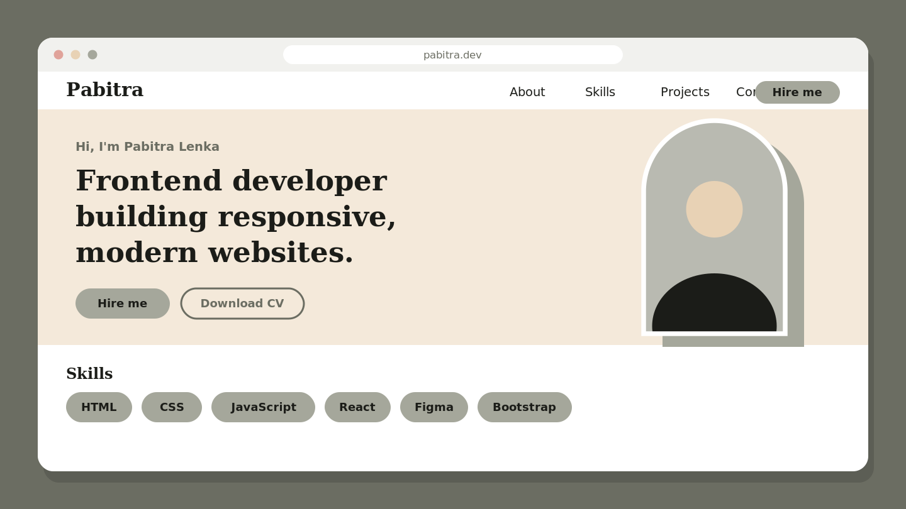

<div align="center">

  # 🌐 Pabitra Lenka — Developer Portfolio

  <p align="center">
    <strong>A sleek, modern, and fully responsive personal portfolio website crafted for frontend developers.</strong>
  </p>

  <p align="center">
    <a href="https://github.com/yourusername/portfolio-main/stargazers"></a>
    <a href="https://github.com/yourusername/portfolio-main/network/members"></a>
    <a href="https://github.com/yourusername/portfolio-main/issues"></a>
    <a href="./LICENSE"></a>
  </p>

  <p align="center">
    <a href="#-live-demo">Live Demo</a> •
    <a href="#-key-features">Key Features</a> •
    <a href="#-tech-stack">Tech Stack</a> •
    <a href="#-project-structure">Project Structure</a> •
    <a href="#-getting-started">Getting Started</a> •
    <a href="#-customization-guide">Customization</a> •
    <a href="#-contact">Contact</a>
  </p>

  <br />

  

</div>

---

## 🌟 Overview

Welcome to the repository for **Pabitra Lenka's Personal Portfolio**. This website is engineered from the ground up with a **mobile-first mindset**, featuring an earthy sage & sand color palette, elegant typography, fluid scroll animations, and lightweight vanilla architecture for near-instant load times.

Whether you're looking for inspiration, evaluating my work, or adapting this code as a template for your own developer portfolio, this project offers a clean and extensible starting point.

---

## 🚀 Live Demo

Check out the live deployment here:
🔗 **[pabitralenka.github.io](https://yourusername.github.io/portfolio-main/)** *(Replace with your actual live URL)*

---

## ✨ Key Features

- 📱 **Mobile-First & Responsive Layout**: Seamless experience across mobile, tablet, laptop, and ultra-wide displays.
- ⚡ **Zero-Dependency Architecture**: Built using pure HTML5, vanilla CSS3, and JavaScript — no heavy bundlers or node runtime required to run.
- 🎨 **Thoughtful Typography & Palette**: Paired with Google Fonts (*Fraunces* serif for luxury headings and *Poppins* for crisp readability) and cohesive sage/neutral tones.
- 💫 **Scroll-Triggered Micro-Interactions**: Smooth entrance and reveal animations powered by [ScrollReveal.js](https://scrollrevealjs.org/).
- 💼 **Featured Projects Showcase**: Grid layout presenting projects with live demo links, source code repositories, and technology tags.
- 📄 **Direct Resume Access**: Quick-download action for the candidate's CV directly from the hero section.
- 📬 **Interactive Contact Section**: Integrated contact form and direct social channels (GitHub, LinkedIn, Instagram, Email).
- ♿ **Semantic & Accessible**: Uses standard HTML5 semantic elements (`<nav>`, `<header>`, `<section>`, `<article>`, `<footer>`) with accessible ARIA tags.

---

## 🛠️ Tech Stack

<div align="center">

| Area | Technologies |
| :--- | :--- |
| **Markup & Core** |   |
| **Styling & Design** |    |
| **Typography & Icons** |   |
| **Animation Library** |  |
| **Version Control** |   |

</div>

---

## 📁 Project Structure

```text
portfolio-main/
├── index.html          # Main HTML document structure & semantic sections
├── style.css           # Custom CSS styles, responsive breakpoints & themes
├── script.js           # ScrollReveal animations & mobile menu behaviors
├── Resume.pdf          # Downloadable candidate curriculum vitae
├── Pabuyt.jpeg         # Profile image for About section
├── pic.png             # Hero banner portrait
├── portfolio.png       # Portfolio preview image
├── trendaura.png       # TrendAura project thumbnail
├── neolearn.png        # NeoLearn project thumbnail
└── README.md           # Repository documentation
```

---

## 💻 Getting Started

Follow these steps to run the portfolio locally on your machine.

### Prerequisites

You only need a modern web browser (e.g., Chrome, Safari, Edge, Firefox).

### Installation & Local Setup

1. **Clone the Repository**
   ```bash
   git clone https://github.com/yourusername/portfolio-main.git
   cd portfolio-main
   ```

2. **Open in Browser**
   - **Method A (Direct)**: Double-click `index.html` or open it with your browser.
   - **Method B (VS Code Live Server)**: Right-click `index.html` and choose **"Open with Live Server"**.
   - **Method C (Python HTTP Server)**:
     ```bash
     python3 -m http.server 8000
     ```
     Then navigate to `http://localhost:8000` in your browser.

---

## 🎨 Customization Guide

Want to personalize this template for your own developer brand? Here is a quick checklist:

1. **Personal Information**:
   - Open [`index.html`](./index.html) and search for `Pabitra Lenka`. Update your name, title, bio, and location.
   - Change email addresses in `mailto:pabitralenka489@gmail.com`.
2. **Social Media & Links**:
   - In [`index.html`](./index.html#L125-L129), update the `href` attributes for your GitHub, LinkedIn, and Instagram profiles.
3. **Resume / CV**:
   - Replace [`Resume.pdf`](./Resume.pdf) with your own resume file keeping the same name (or update the filename in `index.html`).
4. **Images & Headshots**:
   - Replace [`pic.png`](./pic.png) and [`Pabuyt.jpeg`](./Pabuyt.jpeg) with your own headshots/portraits.
5. **Projects**:
   - Update the project cards in `<section id="projects">` with your actual project screenshots, titles, descriptions, live URLs, and GitHub repos.
6. **Styling & Accents**:
   - Tweak color variables and themes in [`style.css`](./style.css) to match your personal aesthetic.


---

## 📬 Contact & Connect

**Pabitra Lenka** — *Frontend Developer*

- 📍 **Location**: Odisha, India
- 📧 **Email**: [pabitralenka489@gmail.com](mailto:pabitralenka489@gmail.com)
- 💼 **LinkedIn**: [linkedin.com](https://www.linkedin.com/in/pabitra-lenka-777423324/e)
- 🐙 **GitHub**: [github.com](https://github.com/pabitralenka07)
- 📸 **Instagram**: [instagram.com](https://www.instagram.com/__lenka_babu._?igsh=MXZyODBoenlvOHZ1dQ==e)

---

## 📄 License

This project is licensed under the [MIT License](LICENSE) — feel free to use it as inspiration or as a base for your own personal portfolio.

<div align="center">
  <sub>Designed & Developed with ❤️ by <a href="mailto:pabitralenka489@gmail.com">Pabitra Lenka</a>. If you found this helpful, consider giving it a ⭐!</sub>
</div>
